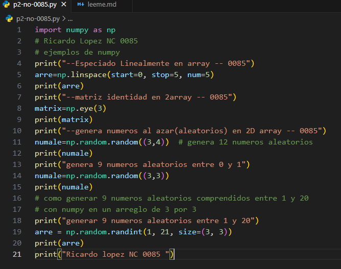
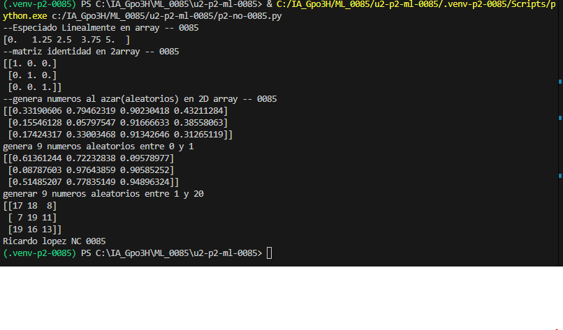

## arre
¿Qué es? Es el nombre de la variable donde se guarda el resultado.

¿Para qué sirve? Permite almacenar y utilizar posteriormente los números generados.

¿Se puede cambiar? Sí. Puedes llamarla datos, numeros o cualquier otro nombre válido.

## np
¿Qué es? Es el alias que normalmente se utiliza para la biblioteca NumPy.

¿Para qué sirve? Permite acceder a sus funciones, como linspace().

¿De dónde sale? Generalmente, de esta instrucción previa:

## linspace()
¿Qué es? Es una función de NumPy.

¿Para qué sirve? Genera una cantidad determinada de números distribuidos uniformemente entre un valor inicial y uno final.

4. start=0
¿Qué es? Es el parámetro que establece el valor inicial.

¿Para qué sirve? Indica que la secuencia comienza en 0.

¿Qué pasa si lo cambias? Si escribes start=2, la secuencia comenzará en 2.

5. stop=1
¿Qué es? Es el parámetro que establece el valor final.

¿Para qué sirve? Indica que la secuencia termina en 1. Por defecto, este valor final está incluido.

¿Qué pasa si lo cambias? Si escribes stop=10, la secuencia terminará en 10.

6. num=5
¿Qué es? Es el parámetro que determina la cantidad de números que se generarán.

¿Para qué sirve? Indica que deben generarse exactamente 5 números.

¿Qué pasa si lo cambias? Si escribes num=10, se generarán 10 números distribuidos uniformemente entre el inicio y el final.

## el codigo

## resultado
